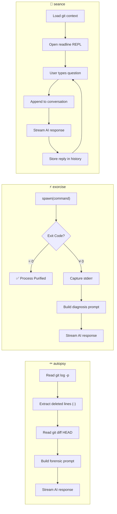

<div align="center">

```
                H A U N T E D   S H E L L
                  Ghost in the Machine • Hacktoberfest Week 4
                Zero-Dependency Local AI Medium for Your Terminal
          
                  [ autopsy ]  •  [ exorcise ]  •  [ seance ]
                Summoning: Ollama / LM Studio (gemma3:4b)
```

# 👻 Haunted Shell

**`Ghost in the Machine`** · Hacktoberfest 2026 Week 4

*A terminal séance where your dead code speaks from beyond the commit grave.*

**Your git history is a graveyard. Deleted functions, buried hotfixes, and crashed processes leave spectral traces in your diffs. Haunted Shell channels them through local open-weight AI—100% offline, zero dependencies, zero cloud leakage.**

`[ ⚰️ autopsy ]` &nbsp;&nbsp; `[ ⚡ exorcise ]` &nbsp;&nbsp; `[ 🔮 seance ]`

<br>

[](https://dev.to/challenges/hf26)
[](https://dev.to/events/challenges/hacktoberfest-week4-2026-10-26)
[](package.json)
[](LICENSE)

</div>

---

<br>

## 🕯️ What Is This?

Every `git log` is an obituary column. Behind every clean `main` branch lie buried functions, excised logic, hasty rollbacks, and broken promises memorialized in cryptic commit messages. When builds crash and tests fail, those buried spirits scream through unhelpful stack traces.

**Haunted Shell** awakens the *Spectral Chronicler*—a Victorian necromancer inhabiting your terminal. It feeds your git diffs, deleted code, and crash logs to a **local open-weight model** running on your own machine, and delivers gothic-flavored yet technically precise diagnostics.

> *No API keys. No cloud. No subscriptions. Just you, your GPU, and the ghosts in your git history.*

<br>

## ⚙️ Tech Stack

<table>
  <tr>
    <td align="center" width="96">
      <a href="https://nodejs.org">
        
      </a>
      <br><strong>Node.js 24</strong>
      <br><sub>ES Modules</sub>
    </td>
    <td align="center" width="96">
      <a href="https://ollama.com">
        
      </a>
      <br><strong>Ollama</strong>
      <br><sub>Local Inference</sub>
    </td>
    <td align="center" width="96">
      <a href="https://ai.google.dev/gemma">
        
      </a>
      <br><strong>Gemma 3</strong>
      <br><sub>Open-Weight LLM</sub>
    </td>
    <td align="center" width="96">
      <a href="https://lmstudio.ai">
        
      </a>
      <br><strong>LM Studio</strong>
      <br><sub>Alt Provider</sub>
    </td>
    <td align="center" width="96">
      <a href="https://git-scm.com">
        
      </a>
      <br><strong>Git</strong>
      <br><sub>Forensic Source</sub>
    </td>
    <td align="center" width="96">
      <a href="https://www.javascript.com">
        
      </a>
      <br><strong>JavaScript</strong>
      <br><sub>ES2024+</sub>
    </td>
  </tr>
</table>

<br>

## 🔮 The Three Spectral Rites

Haunted Shell provides three commands, each a different form of communion with the spirits trapped in your codebase:

### ⚰️ `autopsy` — Post-Mortem on the Commit Graveyard

Exhumes your recent git history—diffs, deleted lines, and commit stats—and feeds the corpse of changes to the local model for forensic analysis.

```bash
haunted-shell autopsy
```

**What it delivers:**

| Output | Description |
|:---|:---|
| 🪦 **The Exhumation** | What functionality was killed and buried in recent commits |
| 👻 **Haunted Bug Warnings** | Latent regressions, broken references, or phantom dependencies |
| 💊 **The Healing Rite** | Specific git commands and code patches to restore the codebase |

<br>

### ⚡ `exorcise <cmd>` — Process Chamber Trial

Spawns any shell command inside an execution chamber, monitors it in real-time, and if it crashes, captures `stderr` and summons a spectral diagnosis.

```bash
haunted-shell exorcise npm test
haunted-shell exorcise "cargo build --release"
haunted-shell exorcise "python manage.py migrate"
```

**Behavior:**

| Exit Code | What Happens |
|:---|:---|
| `0` (Success) | ✅ Confirms the process was purified—no lingering demons |
| `≠ 0` (Crash) | 💀 Traps stderr, invokes the local model, and delivers the diagnosis below |

**Crash diagnosis structure:**

| Output | Description |
|:---|:---|
| 🔥 **The Curse Identified** | What spectral evil brought down the process |
| 🔬 **The Forensic Breakdown** | Exact technical root cause from the stack trace |
| ✨ **The Banishing Incantation** | The precise code patch or shell command to fix it |

<br>

### 🔮 `seance` — Interactive REPL Commune

Opens a persistent, multi-turn conversation with the Spectral Chronicler, pre-loaded with your full repository context.

```bash
haunted-shell seance
```

**Automatic context loaded:**
- Current git branch and working tree status
- Last 5 commits with messages
- `package.json` project info and scripts

**Built-in session rites:**

| Rite | Action |
|:---|:---|
| `/status` | Inspects the working tree state |
| `/diff` | Views uncommitted changes |
| `/log` | Reviews the last 10 commits |
| `/clear` | Purges conversation memory, starts fresh |
| `/exit` | Breaks the circle, returns to the living |

<br>

---

## 🏗️ Architecture

### How Haunted Shell Works

```mermaid
flowchart TD
    subgraph USER ["🧑‍💻 Developer"]
        CMD["Terminal Command"]
    end

    subgraph CLI ["👻 Haunted Shell (index.js)"]
        PARSE["Argument Parser"] --> ROUTE{Command Router}
        ROUTE -->|autopsy| AUTOPSY["Git Forensics Engine"]
        ROUTE -->|exorcise| EXORCISE["Process Execution Chamber"]
        ROUTE -->|seance| SEANCE["Interactive REPL"]
    end

    subgraph GIT ["📁 Git Repository"]
        AUTOPSY -->|"git log -p -n 3"| DIFFS["Commit Diffs & Deleted Lines"]
        AUTOPSY -->|"git diff HEAD"| WORKING["Working Tree Changes"]
        EXORCISE -->|spawn()| PROC["Child Process"]
        PROC -->|exit ≠ 0| STDERR["Captured stderr"]
        SEANCE -->|"git status/log"| CONTEXT["Branch & Commit Context"]
    end

    subgraph AI ["🧠 Local Open-Weight Inference (Offline)"]
        DIFFS --> PROMPT["Prompt Builder"]
        STDERR --> PROMPT
        CONTEXT --> PROMPT
        PROMPT -->|"POST /v1/chat/completions"| LLM{"Local AI Server"}
        LLM -->|"Port 11434"| OLLAMA["Ollama<br>(gemma3:4b / qwen3:4b)"]
        LLM -->|"Port 1234"| LMSTUDIO["LM Studio"]
    end

    subgraph OUTPUT ["🖥️ Streaming Terminal Output"]
        LLM -->|"SSE Stream"| STREAM["Token-by-Token Render"]
        STREAM --> ANSI["ANSI Spectral Colors"]
    end

    CMD --> PARSE
```

### Command Execution Flows



<br>

---

## 🚀 Quick Start

### Prerequisites

| Requirement | Version | Purpose |
|:---|:---|:---|
| [Node.js](https://nodejs.org/) | ≥ 18.0.0 (v24 LTS recommended) | Runtime with native `fetch` and ES modules |
| [Ollama](https://ollama.com/) **or** [LM Studio](https://lmstudio.ai/) | Latest | Local open-weight model inference |
| [Git](https://git-scm.com/) | Any | Repository context for autopsy and seance |

### Step 1 — Pull an Open-Weight Model

```bash
# Google Gemma 3 — 4B parameters (recommended, default)
ollama run gemma3:4b

# Or Qwen 3 — 4B parameters
ollama run qwen3:4b
```

### Step 2 — Clone & Run

```bash
git clone https://github.com/dhruv-gupta-dev/haunted-shell.git
cd haunted-shell

# Run directly
node index.js --help

# Or link globally
npm link
haunted-shell --help
```

### Step 3 — Try It

```bash
# Autopsy your repo's commit graveyard
haunted-shell autopsy

# Exorcise a failing command
haunted-shell exorcise npm test

# Start an interactive séance
haunted-shell seance
```

<br>

---

## 📋 Configuration Reference

All options can be set via CLI flags or environment variables:

| Option | Flag | Env Variable | Default | Description |
|:---|:---|:---|:---|:---|
| Provider | `-p, --provider` | `HAUNTED_PROVIDER` | `ollama` | `ollama` or `lmstudio` |
| Model | `-m, --model` | `HAUNTED_MODEL` | `gemma3:4b` | Any model name available in your provider |
| Endpoint | `-e, --endpoint` | `HAUNTED_ENDPOINT` | *Auto from provider* | Full `/v1/chat/completions` URL |
| Temperature | `-t, --temperature` | — | `0.7` | Sampling temperature (0.0–2.0) |
| Help | `-h, --help` | — | — | Display the CLI grimoire |
| Version | `-v, --version` | — | — | Print current version |

### Default Endpoints

| Provider | Endpoint |
|:---|:---|
| `ollama` | `http://localhost:11434/v1/chat/completions` |
| `lmstudio` | `http://localhost:1234/v1/chat/completions` |

### Usage Examples

```bash
# Use a specific model
haunted-shell --model qwen3:4b autopsy

# Connect to LM Studio
haunted-shell --provider lmstudio seance

# Custom endpoint with lower temperature
haunted-shell -e http://192.168.1.50:11434/v1/chat/completions -t 0.3 autopsy
```

<br>

---

## 🖥️ Live Output Showcase

### `autopsy` — Forensic Post-Mortem

```
⚰️  BEGINNING POST-MORTEM AUTOPSY ON THE REPOSITORY...
Inspecting branch 'main', recent commits, and deleted code tombs...

(A chilling gust of wind rustles through the repository...)

Hark! I, the Spectral Chronicler, have surveyed the wreckage.

1. The Exhumation (Summary of What Was Killed)
   The initial commit appears to be a rudimentary placeholder—a single package.json.
   The subsequent commit is a sprawling 606-line addition to index.js, a desperate
   and ambitious implementation. The excised fields from package.json were deliberate
   removals, signals of a hasty but purposeful restructuring.

2. Haunted Bug Warnings
   • Regression: The empty "test" script remains as a mocking specter.
   • Spectral Echoes: The "haunted-shell" designation implies deep shell integration—
     ensure the bin field properly summons the CLI from any directory.

3. The Healing Rite
   • Verify all package.json metadata fields are restored and accurate.
   • Add a basic smoke test to banish the "no test specified" phantom.
   • Consider modularizing the 600-line monolith into separate ritual chambers.

⚰️  Autopsy complete. May the deleted code rest in peace.
```

### `exorcise` — Crash Diagnosis

```
⚡ INITIATING TRIAL FOR COMMAND: node -e 'undefinedVar.call()'
Executing in process chamber...

ReferenceError: undefinedVar is not defined
    at [eval]:1:1

────────────────────────────────────────────────────────────

⚡ CRASH DETECTED! A curse has possessed the process (Exit Code: 1).
Summoning spectral diagnosis from gemma3:4b...

1. The Curse Identified:
   A phantom variable—undefinedVar—was invoked from the void. It never existed
   in any mortal scope, yet the code demanded it speak.

2. The Forensic Breakdown:
   ReferenceError thrown at eval:1:1. The identifier 'undefinedVar' was never
   declared in the lexical scope before the .call() method was invoked upon it.

3. The Banishing Incantation:
   Declare the variable before summoning it, or guard with optional chaining:

     const undefinedVar = getHandler?.() ?? fallbackFn;
     undefinedVar.call(thisArg);

🔮 The exorcism rite concludes.
```

<br>

---

## 📦 Zero-Dependency Design Philosophy

This project uses **zero npm packages**. Every capability is built on Node.js native APIs:

| Capability | Native API Used | Replaces |
|:---|:---|:---|
| HTTP requests & streaming | Global `fetch` + `ReadableStream` | axios, node-fetch, got |
| SSE parsing | Manual `data:` line parser | eventsource, openai SDK |
| Interactive REPL | `node:readline/promises` | inquirer, prompts |
| Process execution | `node:child_process` (spawn) | execa, shelljs |
| ANSI colors | Raw escape sequences | chalk, kleur, picocolors |
| CLI argument parsing | Manual argv walker | commander, yargs, meow |
| File system | `node:fs` (readFileSync) | fs-extra |
| Color support detection | `NO_COLOR` / `isTTY` check | supports-color |

**Why zero dependencies?**
- 🔒 **Zero supply-chain attack surface** — no `node_modules`, no transitive dependencies
- ⚡ **Instant startup** — no dependency resolution overhead
- 📏 **Single-file simplicity** — the entire CLI is one readable `index.js`
- 🎯 **Node.js 24 LTS** — modern built-ins make external packages unnecessary

<br>

---

## 📜 Why Open-Weight AI Matters Here

This project was built for [**Hacktoberfest 2026: Week 4 — Ghost in the Machine**](https://dev.to/events/challenges/hacktoberfest-week4-2026-10-26) under the `#hf26challenge` tag.

When diagnosing crashes or inspecting git diffs, your terminal sees **everything**: private source code, internal paths, environment variables, API tokens leaked in logs, and proprietary business logic. Routing that through a cloud API means trusting a third party with your most sensitive development context.

By running inference locally with open-weight models like **Google Gemma 3**:

| Benefit | Why It Matters |
|:---|:---|
| 🔐 **Absolute Privacy** | Diffs, stack traces, and error logs never leave `localhost` |
| 🌐 **Offline Resilience** | Works on planes, trains, off-grid cabins, and restricted networks |
| 💰 **Zero Cost** | No API keys, no rate limits, no surprise token bills |
| 🔧 **Full Control** | Swap models, fine-tune, or modify behavior without vendor permission |
| 🏠 **Permanent Ownership** | Your dev tools can't be deprecated, rate-limited, or repriced by an upstream provider |

<br>

---

## 🏆 Hacktoberfest 2026 — Challenge Info

| Detail | Value |
|:---|:---|
| **Challenge** | [Hacktoberfest Open-Source AI Challenge: Week 4](https://dev.to/events/challenges/hacktoberfest-week4-2026-10-26) |
| **Theme** | 🎃 Ghost in the Machine (Halloween / Día de los Muertos) |
| **Required Tag** | `#hf26challenge` |
| **Hub** | [HF26 DEV Challenge Hub](https://dev.to/challenges/hf26) |

<br>

---

## ⚖️ License

MIT © [Dhruv Gupta](https://github.com/dhruv-gupta-dev)

<div align="center">
<br>

*The spirits are restless. Your terminal awaits.*

🕯️👻🕯️

</div>
