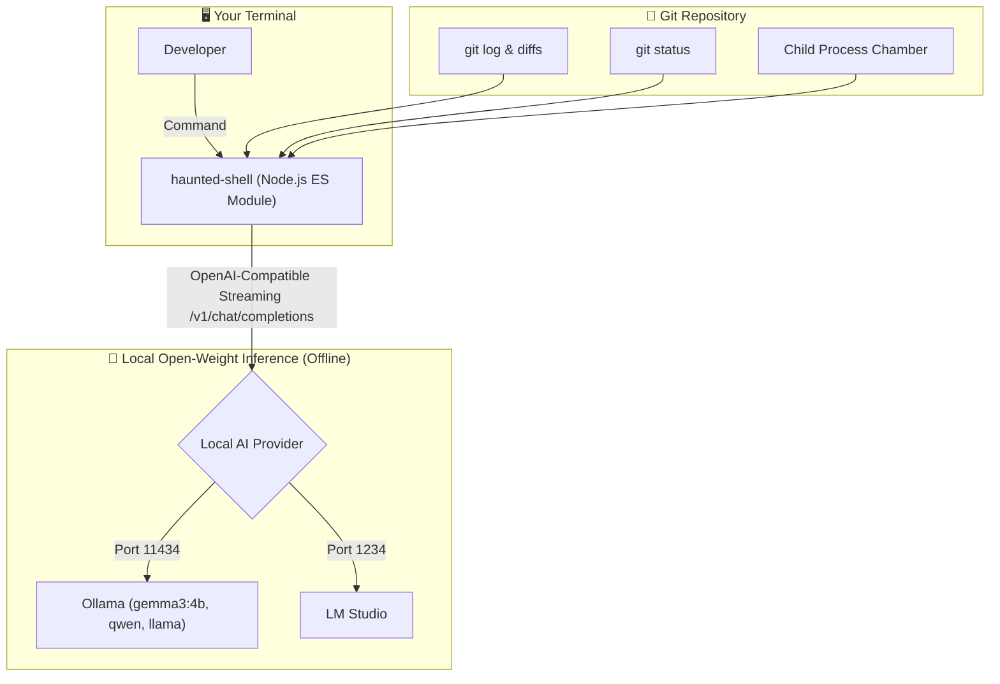

# 👻 Haunted Shell

> **Ghost in the Machine • Hacktoberfest 2026 (Week 4 DEV Challenge Entry)**  
> *A zero-dependency Node.js ES module CLI connecting local open-weight AI models to your git repository and shell.*

[](https://dev.to/challenges/hf26)
[](LICENSE)
[](https://nodejs.org/)
[](package.json)
[](https://ollama.com)

```text
      .---.       H A U N T E D   S H E L L
     /  o o  \      Ghost in the Machine • Week 4
    |   ^   |     Zero-Dependency Local AI Medium for Your Terminal
     \ ~-~ /      Default: Ollama / LM Studio (gemma3:4b)
      |||||       
```

---

## 🕯️ Overview

**Haunted Shell** is a lightweight, zero-dependency command-line medium that awakens the spectral memories lingering within your terminal and git history. It channels local, open-weight AI models via **Ollama** (`http://localhost:11434/v1/chat/completions`) or **LM Studio** (`http://localhost:1234/v1/chat/completions`) using standard OpenAI-compatible endpoints.

Instead of cloud APIs with rate limits and subscriptions, Haunted Shell operates **completely offline** on your machine. Your private git history, diffs, and crash traces never leave your localhost.

---

## 🔮 Three Core Rites (Commands)

### 1. `autopsy`
> *Exhumes git log diffs, excised corpses of deleted code, and working tree wounds to diagnose haunted bugs.*

```bash
haunted-shell autopsy
```
* **What it does**: Scans your git commit tree, extracts excised lines (`-` lines from diffs), and feeds the cadaver of changes to the local model.
* **Output**:
  * **The Exhumation**: An account of what was buried in recent commits.
  * **Haunted Bug Warnings**: Latent regressions, broken references, or architectural ghosts.
  * **The Healing Rite**: Practical git actions and code fixes to restore balance to your codebase.

---

### 2. `exorcise <command...>`
> *Executes a shell command in a process chamber, captures stderr on failure, and summons a spectral diagnosis.*

```bash
haunted-shell exorcise npm test
haunted-shell exorcise "node -e 'throw new Error(\"Haunted crash!\")'"
haunted-shell exorcise cargo build
```
* **What it does**: Spawns the command and monitors its execution.
  * If the command succeeds (`exit code 0`), it confirms the process was purified with no lingering demons.
  * If the command crashes (`exit code != 0`), it captures the error trace and invokes the model to perform an emergency exorcism.
* **Output**:
  * **The Curse Identified**: A dramatic summary of what brought the process down.
  * **The Forensic Breakdown**: Exact technical root cause behind the stack trace.
  * **The Banishing Incantation**: The exact code patch or terminal command to purge the defect.

---

### 3. `seance`
> *Summons an interactive readline REPL with live repository context.*

```bash
haunted-shell seance
```
* **What it does**: Casts a protective circle and establishes a multi-turn conversation with the **Spectral Chronicler**. Loads your current git branch, uncommitted status, recent commits, and `package.json` scripts directly into the local model's context.
* **Special In-Session Rites**:
  * `/status` — Inspects the state of the living working tree.
  * `/diff` — Views uncommitted wounds.
  * `/log` — Reviews the graveyard of past commits.
  * `/clear` — Cleanses memory and purifies the communion circle.
  * `/exit` — Breaks the circle and returns to the living.

---

## 🏗️ Architecture



---

## ⚡ Zero-Dependency Philosophy

Built from scratch utilizing modern **Node.js 24 LTS native capabilities**:
* **Native ES Modules**: Clean `import` syntax with `package.json` `"type": "module"`.
* **Zero npm dependencies**: No heavy frameworks, no bloated `node_modules` folders.
* **Native `fetch` & Streaming**: Streams Server-Sent Events (SSE) directly from local OpenAI-compatible endpoints with real-time token rendering.
* **Native `node:readline/promises`**: Smooth interactive REPL interface for the `seance` command.
* **Native ANSI Palettes**: Built-in spectral color engine that respects `NO_COLOR` and non-TTY environments.

---

## 🚀 Quick Start

### 1. Requirements
* [Node.js](https://nodejs.org/) v18.0.0 or higher (v24 LTS recommended).
* [Ollama](https://ollama.com/) or [LM Studio](https://lmstudio.ai/) running locally.

### 2. Summon an Open-Weight Model
With Ollama:
```bash
ollama run gemma3:4b
```

### 3. Install & Link
From this directory:
```bash
# Link the CLI globally
npm link

# Or run directly with node
node index.js --help
```

---

## ⚙️ Configuration & Options

| Flag | Env Variable | Default | Description |
| :--- | :--- | :--- | :--- |
| `-p, --provider` | `HAUNTED_PROVIDER` | `ollama` | Model provider (`ollama` or `lmstudio`) |
| `-m, --model` | `HAUNTED_MODEL` | `gemma3:4b` | Model identifier (e.g. `gemma3:4b`, `qwen3:4b`) |
| `-e, --endpoint` | `HAUNTED_ENDPOINT` | Provider default | OpenAI-compatible endpoint URL |
| `-t, --temperature` | — | `0.7` | Sampling temperature for responses |
| `-h, --help` | — | — | Show CLI help grimoire |
| `-v, --version` | — | — | Print version |

### Examples with Providers
```bash
# Connect to Ollama with a custom model:
haunted-shell --model qwen3:4b autopsy

# Connect to LM Studio on port 1234:
haunted-shell --provider lmstudio --model local-model seance

# Exorcise a failing test suite:
haunted-shell exorcise npm test
```

---

## 📜 Why Open-Source AI Matters

This project was crafted for **Hacktoberfest 2026: Week 4 (Ghost in the Machine)** under the `#hf26challenge` banner.

When developing software, your git history and crash logs contain sensitive intellectual property, environment tokens, and private commit messages. By routing your terminal diagnostics through local open-weight models like **Google Gemma 3**, your code:
1. **Never touches third-party cloud servers**: Operates 100% locally and privately.
2. **Works completely offline**: Even when internet connectivity is severed.
3. **Incurs zero token costs**: Free and unrestricted local inference.

---

## ⚖️ License

MIT © Dhruv Gupta
